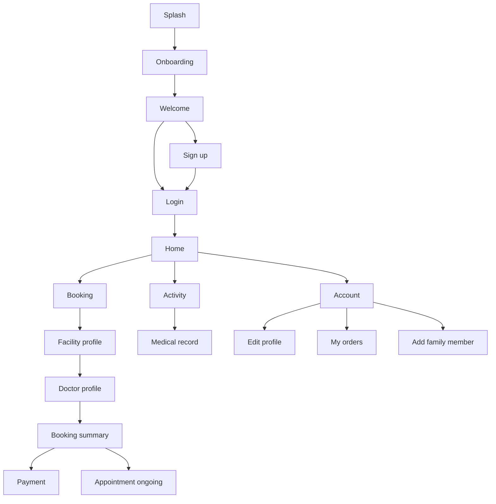
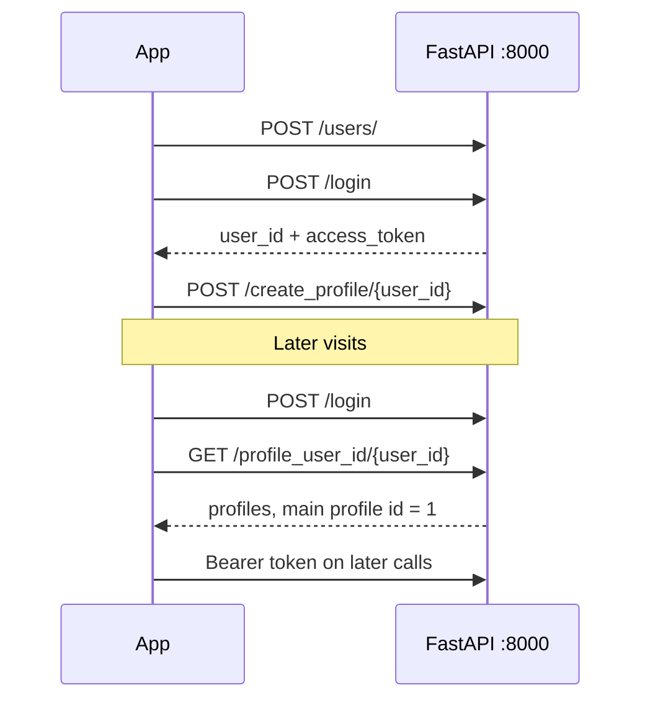

# MediMate

Flutter client for **MediMate**, a healthcare booking app for the Tugas Besar Pemrograman Visual (Kelompok 1, 2024). Patients sign up, pick a profile, browse Bandung hospitals and clinics, book a doctor, and review appointments and medical records.

The API lives in a separate repo: [WebServiceTubesProvisKel1](https://github.com/rakhargo/WebServiceTubesProvisKel1). Start that service before running the app. Every request goes to `http://127.0.0.1:8000`.

## Team

| Name | NIM |
| --- | --- |
| Rakha Dhifiargo Hariadi | 2209489 |
| Ahmad Taufiq Hidayat | 2202074 |
| Muhammad Rizki Revandi | 2205027 |
| Themy Sabri Syuhada | 2203903 |
| Muhammad Rafie Alhabsyi Setiawan | 2202400 |

## What the app does

- Onboarding, welcome, sign up, and login. Session is a JWT plus the active profile id.
- One account can hold several profiles (self and family). `isMainProfile = 1` is the account owner.
- Home shows the active profile, service shortcuts, and health articles.
- Booking lists facilities and specialties, then a facility, a doctor, a schedule, and a visit reason.
- Confirming a booking creates an appointment with status `ongoing`. Payment choices on the summary screen are On the Site, QRIS, and virtual account (BCA, Mandiri, BNI, BRI).
- Activity splits appointments into ongoing and recent, and opens a medical record.
- Account covers edit profile, orders, help, settings, add family member, and logout.



## How it talks to the API



Login stores the raw login JSON and passes it into `MainApp`. Each tab reads `access_token` from that JSON and sends `Authorization: Bearer <token>`.

## Run

Requirements: Flutter SDK `>=3.3.3 <4.0.0`, and the webservice listening on port 8000.

```bash
flutter pub get
flutter run
```

The base URL is hardcoded as `http://127.0.0.1:8000` in the API classes and in the login and sign-up screens. On an Android emulator that address is the emulator itself, so point those strings at `http://10.0.2.2:8000`. On a physical device, use the computer's LAN address.

Targets present in the project: Android, iOS, Web, macOS, Linux, and Windows.

## Screens

| Area | File | Role |
| --- | --- | --- |
| Entry | `lib/main.dart` | Splash, then `MainApp` with the four tabs |
| Onboarding | `lib/Onboboarding/` | Three intro slides, then welcome |
| Auth | `lib/page/Screens/` | Welcome, login, sign up |
| Home | `lib/page/Utama/home.dart` | Greeting, services, articles, QR entry |
| Booking | `lib/page/Utama/booking.dart` | Facilities and specialties |
| Facility | `lib/page/hospitalProfile.dart` | One hospital or clinic and its doctors |
| Doctor | `lib/page/doctor_profile.dart`, `detailDoctor.dart` | Profile, schedule, visit reason |
| Summary | `lib/page/bookingSummary.dart` | Review and `POST /create_appointment/` |
| Payment | `lib/page/Payment/choose_payment_method.dart` | On site, QRIS, virtual account |
| Activity | `lib/page/Utama/activity.dart` | Ongoing and recent visits |
| Record | `lib/page/medicalRecord.dart` | Record tied to an appointment |
| Account | `lib/page/Utama/account.dart` | Profile menu |
| Profile | `lib/page/Account/`, `CreateProfilePage.dart` | Edit, orders, family member |
| Help | `lib/page/Account/support.dart`, `settings.dart` | FAQ and settings |

Bottom navigation (`lib/bottomNavBar.dart`): Home, Booking, Activity, Account.

## Project layout

```text
lib/
  main.dart                 app entry and tab shell
  bottomNavBar.dart
  Onboboarding/             intro slides
  page/                     screens
  provider/
    api/                    HTTP clients (ChangeNotifier)
    model/                  Dart models for API JSON
assets/                     icons and images bundled in the app
```

API clients and the endpoints they call:

| Client | Endpoints |
| --- | --- |
| `profile_api.dart` | `/profile_user_id`, `/profile`, `/profile_picture`, `/create_profile`, `/profile_relation`, profile update |
| `healthFacility_api.dart` | `/health_facility`, facility by id, logo, photo, RS–poli relations |
| `doctor_api.dart` | `/doctor`, by id and poly, picture, schedule, schedule update |
| `appointment_api.dart` | appointments by profile and id, create, update, medical record |
| `specialistAndPoliclinic_api.dart` | specialties, icons, judul poli, RS–poli links |

Sign up and login call `/users/`, `/login`, and `/create_profile/{user_id}` directly with `package:http`.

## Stack

Flutter, Material 3, `provider`, `http`, `shared_preferences`, `flutter_svg`, `smooth_page_indicator`, `intl`, `image_picker`, `file_picker`, `datetime_picker_formfield`, `flutter_native_splash`, `qr_code_scanner`.

Splash color is `#365486` with `assets/images/splash/logo.png`.

## Notes

- Appointment status values used by the UI are `ongoing` and `recent`.
- A new profile is created with `userPhoto: dummy.png` and `isMainProfile: 1`. Family members are extra profiles on the same user.
- Articles on Home are local sample cards. The API also exposes `/health_article`.
- Forgot-password screens exist under `lib/page/Forgot/` and are not wired to an API.
